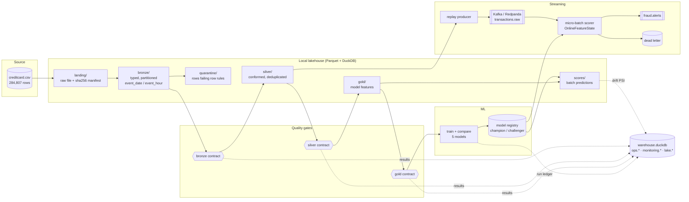

# Architecture

## Layers

| Layer | Grain | Format / partitioning | Written by | Guarantees |
|---|---|---|---|---|
| landing | file | original CSV + `_manifest.json` | `ingest.download` | byte-identical to source, checksum-verified |
| bronze | source row | Parquet, `event_date=/event_hour=`, ZSTD | `ingest.load_bronze` | explicit schema, lineage columns, duplicates kept |
| silver | distinct transaction | Parquet, `event_date=` | `transform.build_silver` | unique `transaction_id`, typed, bad rows quarantined |
| gold | distinct transaction | Parquet, `event_date=` | `transform.build_gold` | leakage-free window features, same grain as silver |
| scores | transaction | Parquet, `event_date=` | `score.batch_score` | partition overwrite (idempotent) |

## Warehouse objects (`data/warehouse.duckdb`)

| Object | Purpose |
|---|---|
| `lake.bronze_transactions`, `lake.silver_transactions`, `lake.gold_features` | views over the Parquet layers for ad-hoc SQL |
| `ops.pipeline_runs` | run ledger: step, status, duration, rows in/out |
| `ops.dq_results` | every contract check result, per run |
| `ops.scoring_runs` | rows scored / alerts per partition and model version |
| `monitoring.feature_drift` | PSI per feature per scoring batch |

See [`queries.sql`](queries.sql) for example operational queries.

## Streaming semantics

1. The producer replays silver in event-time order (`--speedup` controls pacing). Labels are
   not sent, because in production they only arrive later as chargebacks.
2. The consumer polls a micro-batch, validates payloads and routes malformed or late events
   to a dead-letter sink.
3. Window features are computed by `OnlineFeatureState`, which mirrors `gold_features.sql`
   exactly. `tests/test_feature_parity.py` fails the build if they diverge.
4. Scored batches are written to `scored/offsets_<first>_<last>.parquet`. Then alerts are
   published, and only after that is the offset committed. If the process crashes after the
   write, the batch is replayed and the same file is overwritten, so no duplicates appear.
5. On restart, the last hour of events is reloaded from the scored sink to rebuild the window
   state, so features stay correct across restarts.
